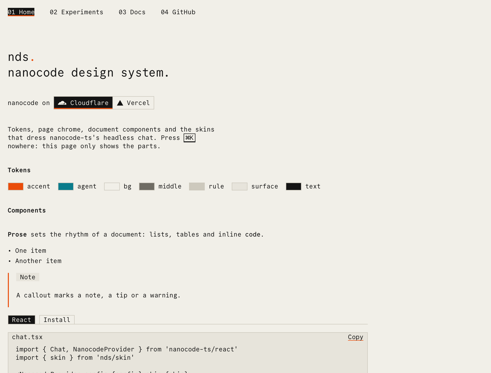
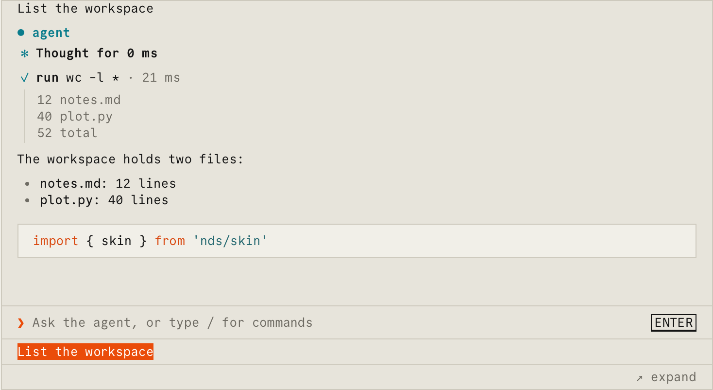
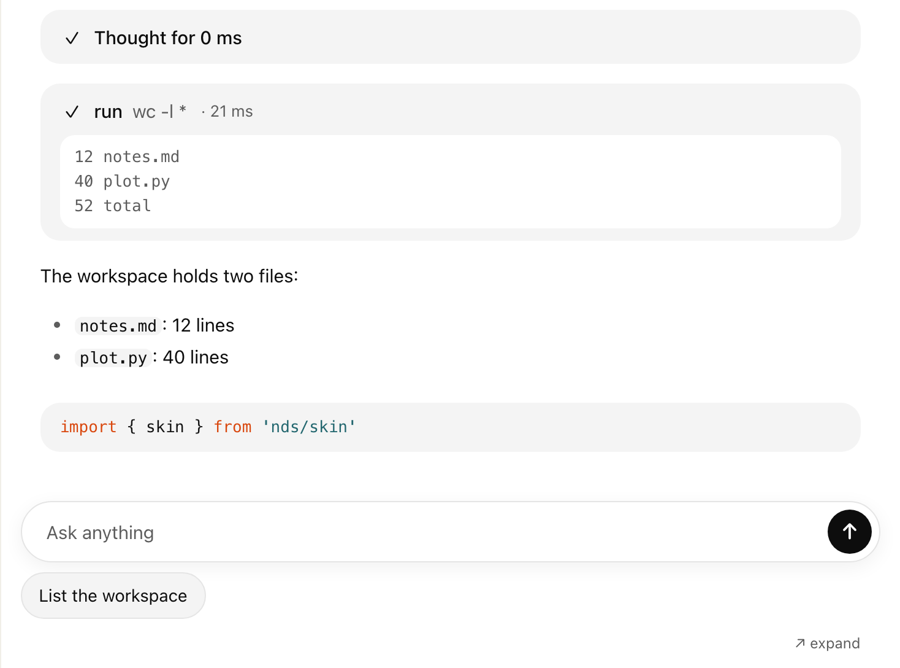
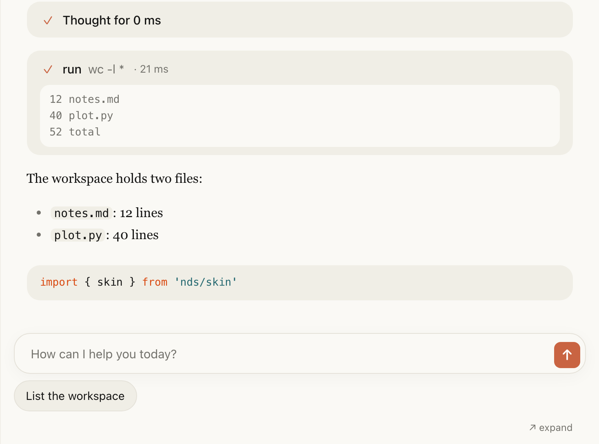

<h1 align="center">nds</h1>

<p align="center">
  <a href="#overview">Overview</a> · <a href="#getting-started">Getting Started</a> · <a href="#entrypoints">Entrypoints</a> · <a href="#development">Development</a> · <a href="#license">License</a>
</p>

<p align="center">
  
</p>

## Overview

nds is the nanocode design system: the tokens, page chrome, document components and chat skins of [nanocode.xyz](https://nanocode.xyz) and its demos, styled with [Zyzz](https://zyzz.style).

[nanocode-ts](https://github.com/nanocodexyz/nanocode-ts) ships the chat as headless React components that render unstyled HTML. nds dresses them. An application takes the behavior from `nanocode-ts/react` and the look from `nds`, or from its own skin.

The same headless chat under three of the seven themes: nanocode, ChatGPT and Claude.

<p align="center">
  
</p>

<p align="center">
  
</p>

<p align="center">
  
</p>

```tsx
import { Config } from 'nanocode-ts/client'
import { Chat, NanocodeProvider } from 'nanocode-ts/react'
import { skin } from 'nds/skin'
import 'nds/zyzz.css'

// 1. The transport is the application's: Cloudflare, Vercel, or its own.
const config = Config.create({ transport })

// 2. The components are nanocode-ts's, and the skin is nds's.
export function Agent() {
  return (
    <NanocodeProvider config={config} skin={skin}>
      <Chat />
    </NanocodeProvider>
  )
}
```

## Getting Started

### 1. Install

Each commit that is released has a tarball named after it. Zyzz must be the version nds was compiled with.

```sh
npm install https://github.com/nanocodexyz/nds/releases/download/build-<commit>/nds-<commit>.tgz zyzz@0.0.40
```

The chat entrypoints (`nds/skin`, `nds/themes`, `nds/clones`, `nds/agent`) also need `nanocode-ts`. The root and `nds/site` do not.

### 2. Set Up Zyzz

Follow the [Zyzz setup guide](https://zyzz.style/docs/introduction/getting-started) for the bundler (`zyzz/vite`, `zyzz/next`, `zyzz/esbuild`). nds ships compiled modules with their contracts, so the application's own `style` calls compile against the same tokens.

### 3. Load the Styles and the Font

Import the stylesheet once, put `body` on `<body>`, and declare Commit Mono. The font file ships as `nds/fonts/CommitMono-VF.woff2`.

```tsx
import 'nds/zyzz.css'
import { styles } from 'nds/site'
import { fontFace } from 'zyzz/web'

// The application serves the font, so the application declares the face.
fontFace({
  fontDisplay: 'swap',
  fontFamily: 'CommitMono',
  fontStyle: 'normal',
  fontWeight: '200 700',
  src: 'url("/fonts/CommitMono-VF.woff2") format("woff2")',
})

document.body.className = styles.body().className
```

### 4. Compose a Page

`nds/site` holds the page chrome of nanocode.xyz, and the root holds the document components.

```tsx
import { Callout, Card, Cards, Kbd } from 'nds'
import { Header, Lead, Main, Page, Title } from 'nds/site'

export function Home() {
  return (
    <>
      <Header current="Home" />
      <Main>
        <Page>
          <Title subtitle="SDK for frontier embedded agents.">nanocode</Title>
          <Lead>
            Press <Kbd>⌘K</Kbd> to search.
          </Lead>
          <Callout data-callout="note">Agents run in this tab.</Callout>
          <Cards>
            <Card description="Start a session." title="Getting Started" to="/docs" />
          </Cards>
        </Page>
      </Main>
    </>
  )
}
```

### 5. Pick a Theme

A theme is a skin and a few token values. `themeStyle` returns the inline style that applies the tokens to a scope.

```tsx
import { Chat, NanocodeProvider } from 'nanocode-ts/react'
import { claudeTheme, themeStyle } from 'nds/themes'

// The same headless Chat, as a Claude-style conversation.
export function Agent() {
  return (
    <div data-theme={claudeTheme.id} style={themeStyle(claudeTheme)}>
      <NanocodeProvider config={config} skin={claudeTheme.skin}>
        <Chat />
      </NanocodeProvider>
    </div>
  )
}
```

`nds/agent` is a whole demo chat in one component. A page passes its transport and gets the model picker, the wallet, plans, hands and the three looks.

```tsx
import { Agent } from 'nds/agent'

// connect returns the page's transport, keyring and optional plans client.
export function Demo() {
  return <Agent connect={connect} harnesses={harnesses} storage="demo" theme="nanocode" wallet={wallet} />
}
```

### 6. (Optional) Custom Styles

The `style` and `variants` helpers build an application's own parts from the nds tokens.

```tsx
import { style } from 'nds'

namespace styles {
  export const panel = style({
    backgroundColor: 'surface',
    border: '1px solid',
    borderColor: 'rule',
    padding: 'md',
  })
}

export function Panel() {
  return <section {...styles.panel()}>Ready.</section>
}
```

A skin is plain data: a map from part names to props. An application replaces any part, or passes no skin and styles the `data-nc` attributes with its own CSS.

```tsx
import type { Skin } from 'nanocode-ts/react'
import { skin, styles } from 'nds/skin'

// The nds skin with the application's own tool cells.
const custom: Skin = { ...skin, parts: { ...skin.parts, tool: () => ({ className: 'my-tool' }) } }
```

## Entrypoints

| Import | Holds |
| --- | --- |
| `nds` | `tokens`, `style`, `variants`, `vars`, the keyframes, and `Callout`, `Card`, `Cards`, `CodeBlock`, `Diagram`, `Kbd`, `Prose`, `Tab`, `Tabs` |
| `nds/site` | `Header`, `Main`, `Page`, `Title`, `Lead`, `Points`, `Links`, `Demos`, and `styles.body` |
| `nds/skin` | `skin`, the nanocode look of the headless chat, and its `styles` |
| `nds/themes` | `themes`: nanocode, ChatGPT, Claude, Gemini, Paper, Phosphor and Headless, with `themeStyle` |
| `nds/clones` | `ChatGpt` and `Claude`, whole applications in those styles |
| `nds/agent` | `Agent`, a demo chat in one component |
| `nds/highlight` | `themes`, the light and dark code colors for `@pierre/highlights` |
| `nds/zyzz.css` | The stylesheet of every module |
| `nds/fonts/CommitMono-VF.woff2` | Commit Mono, under the SIL Open Font License |

## Development

```sh
npm install              # Install dependencies
npm run build            # Compile to dist: modules, declarations, CSS and Zyzz contracts
npm run check:types      # Check the library and the playground
npm run dev              # Start the playground at http://localhost:5173
npm run release          # Build, pack and publish the release build-<commit>
```

The playground renders the tokens, the components, and the headless chat under each theme with a scripted transport.

## License

[MIT](LICENSE-MIT) or [Apache-2.0](LICENSE-APACHE). Commit Mono is under the [SIL Open Font License](src/fonts/OFL.txt).
